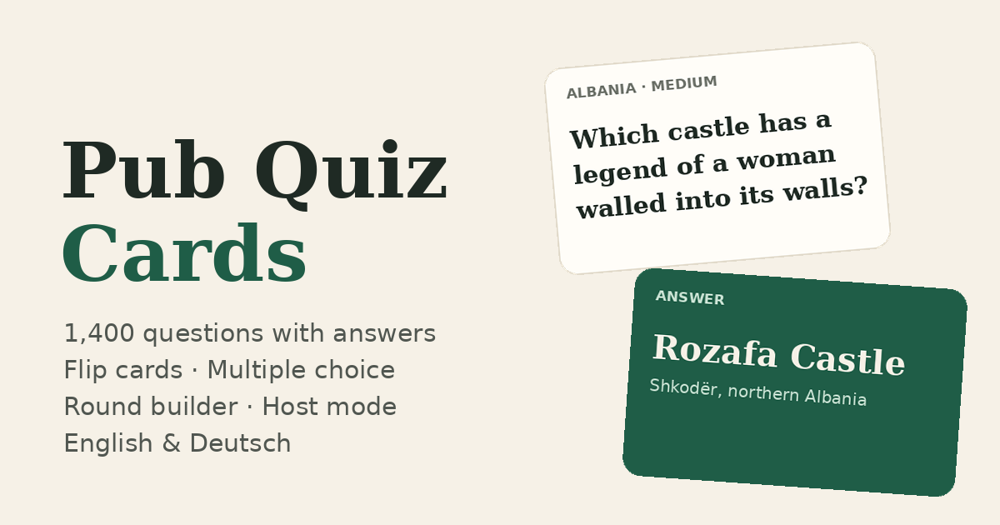

# Pub Quiz Cards

**Live app: https://brahimiarlinda.github.io/pub-quiz-cards/**

1,400 pub quiz questions with answers and short explanations, as flip cards. Run a full quiz night with the round builder, team scoreboard and timer, or practise alone with multiple choice. In English and German.



## Features

**Cards**
- 14 categories: General knowledge, Geography, History, Science & nature, Film & TV, Music, Sport, Food & drink, Books, language & art, Germany & Europe, Politics, 90s, Kids and Albania – 100 each
- Every question has an answer, a short summary and a level (Easy, Medium, Hard)
- **Flip mode**: tap a card to see the answer
- **Multiple-choice mode**: pick from four options; every question has three wrong answers
- Filter by category, level and progress; search questions, answers and summaries; shuffle
- **Got it / Missed** buttons: progress is saved in your browser, so you can review only the questions you missed
- **English / Deutsch** switch for all questions, answers and the interface

**Running a quiz night**
- **Round builder**: choose the number of rounds, questions per round, difficulty and a category for each round (or random/mixed). Questions never repeat within a quiz, and it can avoid questions from your earlier quizzes
- **Host mode**: one big card at a time, with round title slides and a leaderboard after each round
- **Team scoreboard**: add teams and give points with + and −
- **Timer**: optional 15/30/60-second countdown with a beep
- **Show choices**: show A–D options on screen
- **Printable answer sheets** for teams (optionally with the A–D options) and an **answer key** for the host

**Other**
- **Shareable links** to a category, e.g. [`#music`](https://brahimiarlinda.github.io/pub-quiz-cards/#music), [`#albania`](https://brahimiarlinda.github.io/pub-quiz-cards/#albania), or the round builder: [`#rounds`](https://brahimiarlinda.github.io/pub-quiz-cards/#rounds)
- **Works offline** and can be **installed** on a phone's home screen
- **Report a mistake** link on every card opens a pre-filled GitHub issue

### Keyboard shortcuts in host mode

| Key | Action |
| --- | --- |
| → / ← | Next / previous |
| Space or Enter | Reveal answer |
| T | Show or hide the scoreboard |
| Esc | Close |

## Category links

`general` · `geography` · `history` · `science` · `film-tv` · `music` · `sport` · `food` · `books-art` · `germany-europe` · `politics` · `90s` · `kids` · `albania`

## Project files

| File | What it is |
| --- | --- |
| `index.html` | The built app (generated – don't edit by hand) |
| `src/app.html` | The app source, with a `__DATA__` placeholder |
| `data/questions.json` | All questions: `q`, `a`, `s` (summary), `o` (three wrong options), `l` (level), `c` (category) and `de` (German versions) |
| `build.py` | Builds `index.html` and `sw.js` |
| `src/sw.js` | Service worker source for offline use |
| `manifest.webmanifest`, `icons/`, `og.png` | App install details, icons and the link preview image |

To change questions or the app, edit `data/questions.json` or `src/app.html`, then run:

```bash
python3 build.py
```

No dependencies or build tools are needed beyond Python 3.

## Found a mistake?

Use the **Report a mistake** link on the card, or [open an issue](https://github.com/brahimiarlinda/pub-quiz-cards/issues/new).

Facts that change over time (heads of government, World Cup results, euro members, UNESCO site counts, scoring records) were checked in November 2026.
